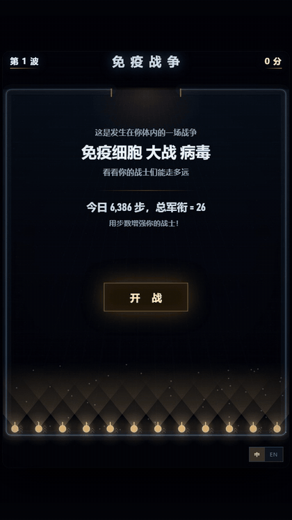
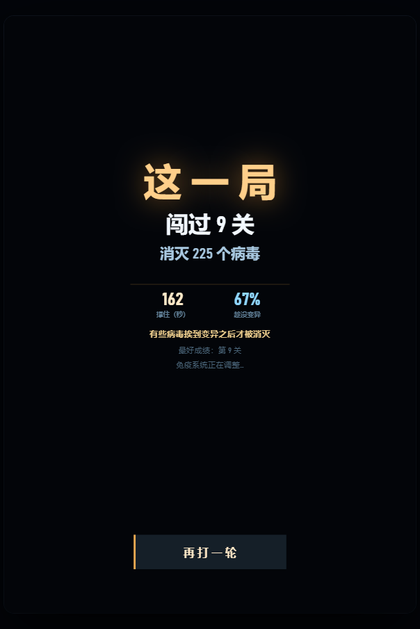

# 免疫战争

一个单文件的竖屏塔防射击小游戏：12 个免疫细胞守在下沿，病毒从顶部入侵口涌进来。

表面上是打怪，实际只想说明一件事 —— **对会逐步变异的病毒，要早期识别、早期消灭。**
你放着它不管，它不会等你：每一秒都在变异。



*开局是一张封面：今天的步数换成「总军衔」，点「开战」才把军衔发给队伍。*

## 怎么玩

- 细胞**自动开火**，你不用瞄准。你只需要决定一件事：**抗体扔在哪。**
- 没被标记的病毒是一团灰色剪影，**打不中**。细胞凑得很近时也能看清一小片（视野锥）。
- 每个细胞每波带一枚抗体，扔出去抛物线飞行，落地炸开，一片区域亮 3.6 秒。
- 病毒一直在变异，**纯计时，跟你有没有看见它无关**。等级越高越耐打、打得越疼 —— 所以别等它变异。
- 每波 20 只起，每波 +2。开场清一色绿株（最好打的那种），蓝、紫、橙随关卡陆续登场。

点战场任意位置 = 指定落点；不点就自动扔向"没标记的病毒最扎堆、最值钱"的那一片。

## 为什么不能拖

变异一次，血量和攻击都往上跳；你拖的那几秒，是你在挨打、在耗细胞。
分数不按等级打折 —— 一只就是一分。**早打不是为了多拿分，是为了少挨打。**

结算页会直接告诉你这一局有多少比例是"趁没变异"消灭的。



## 今天的步数（可选）

开局是一张封面：显示今天走了多少步、换成多少「总军衔」，点「开战」才把军衔发给队伍。

```
总军衔 = round( 36 × (min(步数, 10000) / 10000) ^ 0.7 )
```

- 十二个细胞平分，余数给靠前的席位，单格最多 3 道杠（`^`）
- 军衔**只影响耐久**（×1.00 / 1.10 / 1.22 / 1.35），永远不影响火力
- 数据来源：`index.html?steps=6386`，或控制台 `__game.setSteps(6386)` 再重开一局

接微信运动时，只要把 `STEPS` 的来源换掉，别的一行不用动。

## 运行

双击 `index.html` 就行。没有构建、没有依赖、不联网，也没有任何外部素材 ——
图形全部用 Canvas 现画，音效用 WebAudio 现合成。

## 一点实现

- 竖屏 620×900，固定步长 1/60 秒，掉帧不补课。
- 随机数是确定性的：同一个种子跑出同一局，所以可以用脚本批量跑几千局来调平衡。
- 每打完一局，敌我双方各试几个"战术变异体"，赢的那个留下并写进 localStorage ——
  下一局从更强的状态开始，越打越难，也越打越强。

## 说明

这是个比喻，不是免疫学教材。真实的识别靠分子不靠眼睛，真实的过程比这复杂得多。
游戏里唯一想让你记住的是那一条：**看得见，才打得动；等它变了，就来不及了。**

## 文件

```
index.html     全部代码（一个文件，没有外部素材）
demo.gif       十秒钟的演示
README.md
LICENSE
shot_over.png  结算页截图
```

## 许可

MIT。随便用、随便改，保留版权声明即可。

